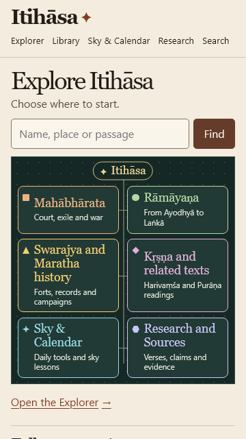

# Itihāsa

Itihāsa connects epic readings, Maratha history, and astronomy through the passages and records behind them. The homepage opens on the whole-project Mind Map. Choose a branch or search for a name, place, passage, or source. A focused reading carries the same selection into the Timeline, Geography, and Sources. Use **All Itihāsa** to return to the complete map. Library, Sky and Calendar, Research, and Search also have their own entrances.



[Desktop map and reading preview](docs/images/map-home-desktop.png)

| Area | Current coverage |
| --- | --- |
| Mahābhārata | 1,995 BORI chapters indexed, 47 individually annotated, and 40 more linked to scene readings. All 18 war days have a cited narrative marker and overview. |
| Rāmāyaṇa | 606 Baroda sargas indexed across all seven kāṇḍas, with 36 annotated readings. |
| Maratha history | Nine periods, 22 dated records, 14 geographic references and four fort or port investigations. |
| Mind Map | Six homepage branches, five guided journeys, 340 content nodes and 500 relationships with source records. |
| Sky and Calendar | Pañchāṅga, Birth Sky, festivals, the observer sky, and the Sūrya Siddhānta workshop. The calculator supports Delhi, Mumbai and Pune for 2024–2027. |

Historical dates in the Arundhatī pilot and Rāmāyaṇa campaign investigation remain unavailable pending independent review. The pilot’s six frames are illustrative. The research notebook distinguishes the modern transit benchmark from historical prereview calculations and quotes attributed dates at their stated precision.

## Launch on Windows

Use Node 24.12.0, npm 11.6.2, CPython 3.14.0 and uv 0.13.10. Run from the repository root.

```powershell
npm.cmd ci
python -m pip install uv==0.13.10
uv sync --locked --project research
$env:ASTRO_TELEMETRY_DISABLED = '1'
$build = Join-Path (Get-Location).Path '.tools/map-home-dist'
npm.cmd run build --workspace @itihasa/web -- --outDir $build
uv run --locked --project research python research/serve_beta.py --port 4327 --dist $build
```

Open the [homepage map](http://127.0.0.1:4327/) or the [Timeline](http://127.0.0.1:4327/explorer/). The Python service hosts the static Astro pages and same-origin calculator API on loopback. If uv is unavailable in the shell and its locked environment already exists, run `./research/.venv/Scripts/python.exe research/serve_beta.py --port 4327 --dist $build`.

## Verify a build

The browser suite starts and stops its own local server. Use port 4326 alongside the manual preview on 4327.

```powershell
npm.cmd run check
$env:PLAYWRIGHT_BROWSERS_PATH = '0'
npx.cmd playwright install chromium --only-shell
$env:ITIHASA_QA_PORT = '4326'
$env:ITIHASA_QA_DIST = $build
$env:ITIHASA_PYTHON = (Resolve-Path research/.venv/Scripts/python.exe).Path
npm.cmd run test:browser
& $env:ITIHASA_PYTHON research/audit_expansion_links.py --dist $build
& $env:ITIHASA_PYTHON -m unittest discover -s research
```

The [CI workflow](.github/workflows/foundation.yml) contains the full reproducibility and content check list. Browser screenshots land in the ignored `test-results/` directory. The [homepage map handoff](docs/Mind-Map-Home.md) records the baseline, performance commands, and review journeys.

## Where changes belong

| Change | Source of truth | Validation or regeneration |
| --- | --- | --- |
| Event or place | `content/mahabharata-atlas.json`, `content/mahabharata-reading.json`, `content/ramayana-atlas.json` or `content/maratha-history.json` | Run the relevant `research/check_*.py` and regenerate the graph and coverage. |
| Relationship | `content/graph-editorial.json` for individually authored links, or `research/build_project_graph.py` for relationships derived from data | Run `python research/build_project_graph.py` to generate `project-graph.json`, `explorer-catalog.json` and `explorer-edges.json`. Give each assertion a source and scope. |
| Homepage branch or guided step | `apps/web/src/lib/map-branches.ts` and `apps/web/src/lib/map-journeys.ts` | Use a catalogue ID or an existing link. The Astro build checks preview IDs and serves one relationship file per work. The link audit validates those files against the complete graph. |
| Passage or annotation | `content/mahabharata-annotations.json`, `content/ramayana-annotations.json`, or `content/library.json` | Run the edition check with `--source-dir` when the Unicode Roman source files are available. Run `python research/build_coverage_registry.py`. |
| Research or calculation | `research/`, `content/source-register.json`, `content/maratha-sources.json` and `packages/contracts/` | Record inputs, frame, convention and tolerances. Run the matching benchmark, replay and review checks before changing the evidence status. |
| Interface | `apps/web/src/` | `npm.cmd run check`, static build and Playwright. |

Edition index regeneration commands are `python research/build_mahabharata_index.py <BORI-source-directory>` and `python research/build_ramayana_index.py <Baroda-source-directory>`. Add `--check` to compare a fresh parse without rewriting the output. The Explorer resolves IDs in `apps/web/src/lib/explorer-state.ts` and joins readings, sources and maps in `apps/web/src/lib/explorer-content.ts`. Timeline and Mind Map use the same ID for an event. The evidence schema is checked with `npm.cmd run contracts:generate`. Research replays keep their manifests in `research/runs/`.

## Credits and reuse

Source editions, modern studies, and map credits are named beside their uses. The Natural Earth outlines are public domain. Upstream Sanskrit e-texts, modern translations, restricted downloads, credentials, personal birth input and transient QA artifacts stay outside Git. This repository has no declared project-wide license. Individual upstream rights and usage notes still apply.

- [Connected Explorer handoff](docs/Connected-Explorer.md)
- [Previous expansion and source audit](docs/Itihasa-Expansion.md)
- [Arundhatī–Vasiṣṭha method and benchmark](docs/Arundhati-Method.md)
- [Historical prereview run](research/runs/arundhati-prereview-v1/manifest.json)
